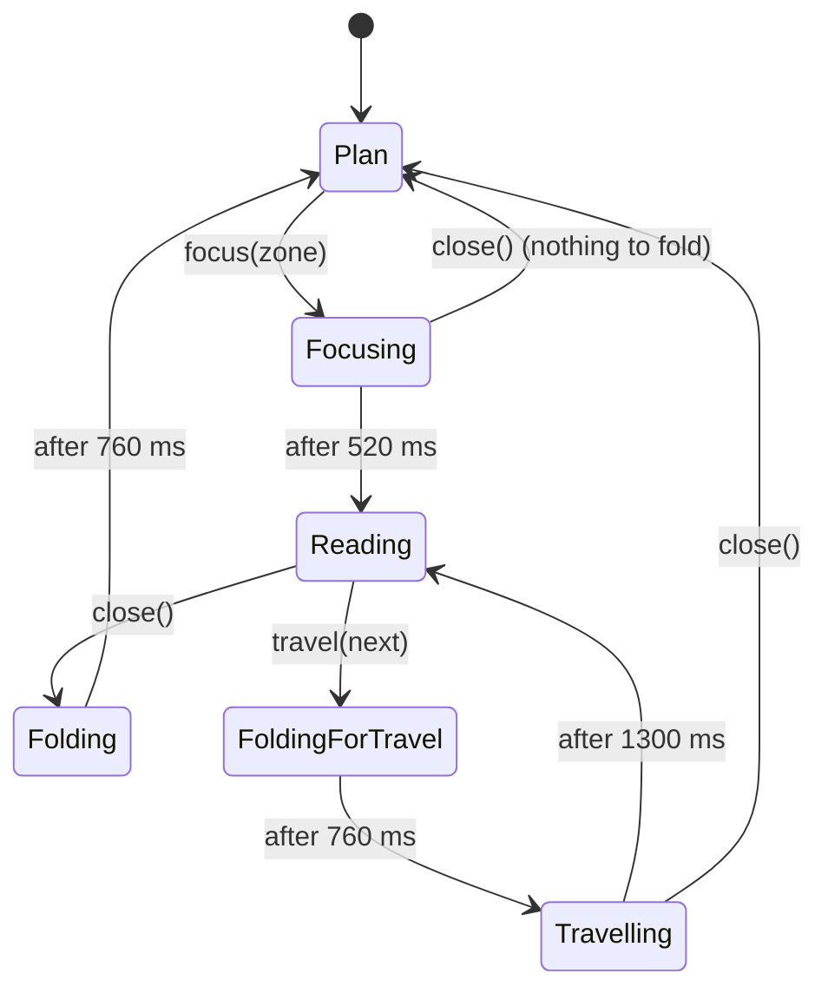

# How the Blueprint CV works

This document explains the app's behaviour end to end: what the visitor sees,
which animation plays when, what triggers it, and where it lives in the code.
All timings below are the real values from `src/styles/global.css`,
`src/three/BlueprintScene.ts` and
`src/hooks/useSheetController.ts`.

---

## 1. The idea in one paragraph

The CV is drawn as a webpage sketched on an architectural blueprint, lying on a
desk and seen from the side (tilted 50° back and turned 30°). The sketched page
is split into five **zones**: About, Experience, Education, Skills and Contact.
Each zone is a thin 3D slab. Hovering a zone makes it **rise** into a block and
project a **hologram** label above it. Clicking a zone makes the **camera lean
in** on it, and the zone's content **unfolds** as a sheet over the blurred
blueprint. Closing **folds** the sheet away and the camera **pulls back**.

---

## 2. Screen anatomy

```
┌──────────────────────────────────────────────────────────────┐
│ Ilian Futekov                          ● HOVER A ZONE — …     │  Header (.bp-head)
│ > JavaScript Developer · React & TS_     CLICK TO OPEN …      │  (hint hidden on mobile)
│                                                              │
│            ╱‾‾‾‾‾‾‾‾‾‾‾‾‾‾‾‾‾‾‾‾‾‾‾‾‾‾‾‾‾‾╲                    │
│          ╱                                    ╲              │  Blueprint plane
│        ╱  ┌ browser chrome / nav sketch ┐      ╲            │  (WebGL canvas, 900×600 plan)
│       │   [ ABOUT ]  [ EXPERIENCE ]    │           │
│       │   [ EDUCATION ] [ SKILLS ]     │           │  5 zones
│        ╲  [ CONTACT ··················· ] ╱            │
│          ╲________ 1440 PX ___________________╱              │  live viewport width (height runs up the left edge)
│                                                              │
│ [01 ABOUT][02 EXPERIENCE][03 EDUCATION][04 SKILLS][05 CONT.] │  Mobile nav (small screens only)
└──────────────────────────────────────────────────────────────┘
```

Layers above the plan, from back to front:

| Layer | Element | Shown when |
|---|---|---|
| Plan view | `.bp-wrap` (header, blueprint canvas, mobile nav) | Always; blurred while a sheet is open |
| Spinner | `<Spinner>` / `.bp-spinner` | Until the blueprint is ready to appear (4.1) |
| Vignette | `.bp-vig` | A zone is focused |
| Loupe reticle | `<Reticle>` / `.bp-reticle` | A zone is focused (fades out once the sheet appears) |
| Sheet overlay | `<Sheet>` / `.bp-ov` | The sheet is being read |

---

## 3. Zones

### 3.1 Layout on the plane (900 × 600 px)

| Zone | Label | Position (x, y) | Size (w × h) | Rise height | Intro delay |
|---|---|---|---|---|---|
| About | ABOUT | 60, 132 | 480 × 176 | 96 px (`h-c`) | 0.20 s |
| Experience | EXPERIENCE | 556, 132 | 284 × 176 | 72 px (`h-a`) | 0.45 s |
| Education | EDUCATION | 60, 324 | 382 × 120 | 52 px (`h-b`) | 0.70 s |
| Skills | SKILLS | 458, 324 | 382 × 120 | 96 px (`h-c`) | 0.90 s |
| Contact | CONTACT | 60, 460 | 780 × 84 | 52 px (`h-b`) | 1.10 s |

Defined in `src/data/cv.ts → zones`.

### 3.2 How the blueprint is built

The blueprint is a real 3D scene drawn with **three.js** on one WebGL canvas
(`src/three/BlueprintScene.ts`). Nothing in it is an HTML element.

| Part | What it is |
|---|---|
| Board | A flat 900 × 600 sheet with a soft drop shadow |
| Zone block | A box stretched from a 14 px slab to its full height (52, 72 or 96 px), with hatched front walls |
| Edges | 1.5 px lines along every edge of the box, pale blue at rest and orange when raised |
| Foundation | The box's bottom edges outline the footprint exactly, plus a shadow that slides out as the block rises |
| Hologram | A card, scan band and projector beam that always face the viewer |

All artwork is **drawn in code** onto canvas textures (`src/three/textures.ts`),
so no image files are downloaded:

- **Board:** grid, the sketched browser window (frame, title bar, address bar,
  nav) and the two dimension lines with the live viewport size.
- **Zone tops:** a miniature of each sheet — text lines for About, a 3×2 grid
  for Experience, a degree card with course chips and a stamp for Education,
  progress bars for Skills, and buttons for Contact — in two versions, at rest
  and raised, cross-faded on hover.
- **Hologram:** `→ OPEN`, the zone's `tipTitle` and `tipSub`.

Textures are painted at 4× and filtered for slanted viewing, so labels stay
sharp on the tilted plan and when zoomed.

### 3.3 Zone states

| State | Trigger | What you see |
|---|---|---|
| **Rest** | Default | 14 px slab, navy bevelled top, small shadow |
| **Raised** | Mouse over it, keyboard focus on its button, or its sheet is open | Block at full height, orange edges, brighter top, larger shadow, white bold label, hologram (hover/focus only) |

---

## 4. Animation catalogue

### 4.1 On page load

**Loading.** The header shows first. The blueprint (three.js, about 135 KB
gzipped) loads as a separate chunk, and a spinner with "LOADING PLAN" sits in
its place meanwhile. The scene then waits for its web fonts, paints every
texture, draws its first frame, and only then fades in over 0.5 s — so the
blueprint appears whole, never piece by piece. If a font never arrives, it
gives up waiting after 4 s and draws with the fallback font.

**Intro.** Times for the blueprint count from the moment it appears.

| Time | What happens | Where | Duration |
|---|---|---|---|
| 0 s | Background grid starts drifting diagonally (loops forever) | `gridDrift` (CSS) | 40 s loop |
| 0.10 s | Name rises in | `rise` (CSS) | 0.9 s |
| 0.25 s | Role line rises in; the `_` caret blinks forever | `rise`, `blink` (CSS) | 0.9 s / 1 s loop |
| 0.40 s | Hint text rises in (desktop only); orange dot pulses | `rise`, `pulse` (CSS) | 0.9 s / 2 s loop |
| 0 → 1.8 s | Blueprint swings from flat and small to the 50° / −30° tilt | `SCENE_IN` | 1.8 s |
| 1.8 s → | Idle sway: gentle rock of ±3° / ±5° (loops) | `SWAY_PERIOD` | 14 s loop |
| 2.0 – 2.9 s | **Rise wave**: each zone rises to full height and settles back, one after another (About → Experience → Education → Skills → Contact) | `WAVE` | 1.4 s each, start = intro delay + 1.8 s |

The rise wave is a hint that the zones are interactive.

### 4.2 Hover / keyboard focus on a zone (plan view)

The zone under the mouse is found by casting a ray from the pointer into the
scene. Keyboard focus on a zone's (hidden) button does the same thing.

| Element | Effect | Timing |
|---|---|---|
| Block | Rises from the 14 px slab to its full height | 0.6 s, slight overshoot `cubic-bezier(.2,.9,.25,1.15)` |
| Colours | Edges turn orange, top gets lighter, label turns white + bold, sketch lines brighten | 0.4 s |
| Shadow | Slides further out and darkens | 0.4 s |
| Hologram card | Appears as a thin vertical sliver, stretches sideways, stutters twice, settles | 0.7 s |
| Hologram (while hovered) | Brief flicker | every 3.5 s |
| | Bright band rolls down the glass | 2.2 s loop |
| | Projector beam from the zone pulses | 1.6 s loop |

**On hover-out** the block lowers in **0.45 s with no overshoot**, and the
hologram collapses in 0.25 s.

Hologram card content: `→ OPEN`, the zone's `tipTitle` and `tipSub`
(from `zones` in `cv.ts`).

The hologram takes priority over the header: on the desktop layout the stage
sits above it (`z-index: 5` vs 4) and the card's backing is 90 % opaque, so when
the About card lands on the name or role line it covers the text instead of
mixing with it.

### 4.3 Opening a zone — the "lean in and read" flow

Triggered by: clicking a zone, pressing Enter/Space on a focused zone, or
tapping a mobile nav button. Handled by `focus(key)` in `useSheetController`.

```
t = 0 ms ── state: open = key, reading = false   → root gets .bp-focus
│  • Camera starts moving: blueprint rotates to face the viewer, slides and
│    zooms so the zone fills ~⅔ of the stage           (1.25 s, ease .7,0,.2,1)
│  • Clicked zone gets .on → stays raised, orange
│  • Header + mobile nav fade out                      (0.5 s)
│  • Vignette darkens the screen edges                 (1 s)
│  • Loupe reticle snaps in: corners shrink onto the zone, crosshair,
│    readout "FOCUS ▸ EXPERIENCE · LOUPE ×2.5"     (reticleIn 1.1 s)
│  • Idle sway stops; hologram cards hidden; plan clicks disabled
│
t = 520 ms ── state: reading = true             → root gets .bp-reading
│  (camera is still moving: the content starts showing early on purpose)
│  • Plan blurs and darkens (blur 2px, brightness .5)  (0.9 s)
│  • Reticle fades out                                  (reticleOut 0.7 s, +0.1 s)
│  • Sheet mounts:
│      – dark scrim fades in                            (0.45 s)
│      – sheet UNFOLDS: point → thin line → full panel  (unfold 1 s)
│      – two orange lines sweep from the centre to top/bottom (1 s)
│      – orange corner marks snap in                    (0.8 / 0.85 / 0.9 / 0.95 s)
│      – title bar fades in (0.7 s); title rises (0.35 s)
│      – footer (prev / next) fades in                  (0.9 s)
│      – focus moves to "Back to plan"; body scrolls to top
│
t ≈ 1.25 s ── camera lands (hidden behind the sheet)
│
t ≈ 1.6 – 3 s ── sheet content animates in (see 4.4)
```

**Zoom maths** (`src/lib/camera.ts`):

```
fit   = min(0.66 × stageWidth / zoneW, 0.62 × stageHeight / zoneH)
wide  = min(1.8, 0.94 × stageWidth / zoneW, 0.62 × stageHeight / zoneH)
scale = clamp( max(fit, wide), 1, 4.2 )
cx,cy = zone centre − plane centre
```

The scene magnifies by `scale`, centres on (`cx`, `cy`) and turns the plan by
the inverse of its 50° / −30° tilt, so the zone ends up flat and facing the
viewer. `wide` is a floor for very wide zones (Contact): at ⅔ of the stage
width they would barely zoom, so they may use up to 94 % of the width until
they reach ×1.8. `scale` is also shown in the reticle readout (`LOUPE ×S`).

### 4.4 Sheet content animations

Delays are measured from the moment the sheet mounts (t = 520 ms above).

**About**

| Element | Animation | Delay |
|---|---|---|
| Intro line | `rise` 0.7 s | 1.15 s |
| Bio | `rise` 0.7 s | 1.25 s |
| LinkedIn / GitHub buttons | `rise` 0.7 s | 1.35 s |
| Facts box | `boxDraw` 0.8 s (draws top → bottom) | 1.10 s |
| Facts grid (4 cells) | `rise` 0.6 s | 1.20 s + 0.10 s each |

**Experience**

| Element | Animation | Delay |
|---|---|---|
| Role cards (5) | `rise` 1.2 s, smooth ease | 1.10 s + 0.32 s each |

Each card shows role @ company, dates (orange), bullet points and tech tags.

**Education**

| Element | Animation | Delay |
|---|---|---|
| University card | `rise` 0.7 s | 1.15 s |
| Orange underline | `drawLine` 0.8 s (draws left → right) | 1.40 s |
| Course chips (10) | `popIn` 0.45 s, bouncy | 1.50 s + 0.06 s each |
| "GRADUATED" stamp | `stamp` 0.7 s (slams in, rotated −8°) | 1.90 s |
| Facts box | `boxDraw` 0.8 s (draws top → bottom) | 1.10 s |
| Facts column (4) | `rise` 0.6 s | 1.25 s + 0.10 s each |

**Skills**

| Element | Animation | Delay |
|---|---|---|
| Group cards (5) | `rise` 0.6 s | 1.15 s + 0.10 s each |
| Orange bar under each title | `fill` 1.2 s (grows left → right) | 1.30 s + 0.12 s per group |
| Skill chips | `popIn` 0.45 s | bar delay + 0.20 s + 0.05 s per chip |

**Contact**

| Element | Animation | Delay |
|---|---|---|
| "Like what you see? Get in touch." | `rise` 0.7 s | 1.15 s |
| Invitation line under it | `rise` 0.7 s | 1.22 s |
| Email button | `rise` 0.7 s, then `pulse` (2 s loop) | 1.30 s / 2 s |
| **COPY EMAIL** button (below the email) | rises with the email button | 1.30 s |
| Green "✓ COPIED" hologram | `copiedHolo` 1.9 s (stretches in, flickers, collapses) + `holoScan` band | on click |
| Links box | `boxDraw` 0.8 s (draws top → bottom) | 1.10 s |
| GitHub, LinkedIn rows | `slideIn` 0.7 s from the right | 1.50 s + 0.15 s each |
| Orange line under each row | `lineSweep` 1 s (sweeps in, then out) | 1.70 s + 0.15 s each |
| "Based in" row | `slideIn` 0.7 s | 2.00 s |

Clicking **COPY EMAIL** writes the address to the clipboard (`ContactSheet.tsx`)
and shows the hologram next to the button for 1.9 s (`COPIED_FOR`, keep it in
sync with `copiedHolo`); clicking again replays it.

**Inside any sheet (mouse devices only):** cards lift 6 px with an orange
border on hover; buttons and links fill orange on hover.

### 4.5 Closing a sheet — the "fold away" flow

Triggered by: **Back to plan**, clicking the dark area outside the sheet, or
**Esc**. Handled by `close()`.

```
t = 0 ms ── state: closing = true               → root gets .bp-closing
│  • Title bar, body and footer fade out                (0.22 s)
│  • Sheet FOLDS: top & bottom close to a line (0–45 %),
│    the line shrinks sideways to a point (45–85 %)     (foldOut 0.72 s)
│  • A glowing orange line flashes at the fold          (closeFlash 0.72 s)
│  • Scrim fades out                                    (0.5 s, +0.1 s)
│  • Plan blur eases to blur 1px / brightness .75
│
t = 760 ms ── state reset (open = null)          → .bp-focus/.bp-reading/.bp-closing removed
   • Sheet and reticle unmount
   • Camera pulls back to the tilted plan view          (1.25 s)
   • Blur clears (0.9 s); vignette fades (1 s); header + mobile nav fade in (0.5 s)
   • Zone loses .on and lowers to a slab                (0.45 s)
   • Idle sway restarts
```

If the visitor closes **before** the sheet appeared (during the first 520 ms),
there is nothing to fold: the camera pulls back straight away.

### 4.6 Moving between sheets — prev / next

Triggered by the **← / →** footer buttons or the **← / →** arrow keys (arrow
keys only while a sheet is showing). Handled by `travel(key)`. Order wraps
around: About → Experience → Education → Skills → Contact → About.

```
t = 0 ms      Current sheet folds away (same as 4.5, 0.72 s)
t = 760 ms    state: open = next zone, reading = false
              • Camera glides across the blueprint to the next zone (1.25 s)
              • Old zone lowers, new zone rises (orange)
              • Reticle re-appears with the new readout (reticleIn 1.1 s)
              • Plan is sharp again, so you can see the travel
t = 2060 ms   state: reading = true → next sheet unfolds (same as 4.3 from 520 ms)
```

Unlike opening from the plan, here the sheet waits for the camera to **land**
before unfolding, so the move across the blueprint is visible.

### 4.7 Exploring the plan on small screens — pan and zoom

On screens that show the mobile nav (≤ 820 px wide or ≤ 560 px tall) the
blueprint is small, so the visitor can move and magnify it and then tap a zone
directly. Two controls sit just above the nav bar (`ViewControls.tsx`):

| Control | Where | Effect |
|---|---|---|
| Vertical zoom slider with a `×1.0` readout above it | Bottom left | Slide up to zoom in: zooms continuously from ×1 to ×3 (steps of 0.1) around the centre of the stage |
| Reset button | Bottom left, under the slider | Back to the untouched plan (disabled when already there) |
| Joystick | Bottom right | Push the stick to fly over the plan: the further it is pushed, the faster (up to 520 px/s, × √zoom). Pushing right looks right, so the plan slides left. Releasing it re-centres the stick and stops |
| One-finger drag on the blueprint | Stage | Pans freely; the plan follows the finger |

- A touch that travels less than 8 px is a tap and opens the zone under it; a
  longer one is a drag and never opens a zone.
- Panning is limited so the plan can't be pushed out of sight
  (±320 × zoom horizontally, ±220 × zoom vertically).
- While the slider, joystick or a finger drives the plan it follows exactly;
  reset and keyboard steps glide with a short ease.
- Pan and zoom move the scene's camera window, so the plan is redrawn at the
  new size and stays sharp.
- With a keyboard, the arrow keys work on both the slider and the focused
  joystick (130 px per press).
- Opening a zone (tap or nav button) resets the view, so the camera always
  leans in from the untouched plan and returns to it on close.
- The controls fade out with the header and nav while a zone is focused.

State and drag handling live in `usePlanView`; the maths is in `lib/view.ts`.

### 4.8 Always-running ambient animations

| Animation | Where | Loop |
|---|---|---|
| `gridDrift` | Page background grid | 40 s |
| `sway` | Blueprint (paused while a zone is focused) | 14 s |
| `blink` | Caret after the role line | 1 s |
| `pulse` | Hint dot (desktop), email button in Contact | 2 s |
| `ticker` | Orange dot next to the sheet title | 1.4 s |

---

## 5. State machine

All sequencing lives in `useSheetController` (`src/hooks/useSheetController.ts`).

```ts
interface SheetState {
  open: ZoneKey | null; // zone the camera is on (null = plan view)
  reading: boolean;     // the sheet is mounted
  closing: boolean;     // the sheet is folding away
}
```



| State | `open` | `reading` | `closing` | Root classes |
|---|---|---|---|---|
| Plan | `null` | false | false | `bp-root` |
| Focusing / Travelling | zone | false | false | `bp-root bp-focus` |
| Reading | zone | true | false | `bp-root bp-focus bp-reading` |
| Folding | zone | true | true | `bp-root bp-focus bp-reading bp-closing` |

The overlays (vignette, reticle, sheet, header fade) are driven by these **root
classes** in CSS. The blueprint gets the same state as two calls into the
scene: `setCamera()` (lean in / pull back) and `setActive()` (keep a zone raised).

**Timing constants** (keep them in sync with the CSS and with `CAMERA_MOVE` in `BlueprintScene.ts`):

| Constant | Value | Matches |
|---|---|---|
| `REVEAL_ON_FOCUS` | 520 ms | Sheet reveal while the camera is still zooming |
| `REVEAL_AFTER_TRAVEL` | 1300 ms | Camera transition 1.25 s + buffer |
| `FOLD_OUT` | 760 ms | `foldOut` 0.72 s + buffer |

**Robustness:** a single timer handles every step, so a new action always
cancels the pending one. Clicks during a fold are ignored (`closing` guard).
Rapid clicking can't leave the app half-open.

---

## 6. Inputs and controls

| Input | Plan view | Sheet open |
|---|---|---|
| Mouse hover on a zone | Rise + hologram | — (plan is disabled) |
| Click on a zone | Open (4.3) | — |
| Click outside the sheet | — | Close (4.5) |
| **Back to plan** button | — | Close |
| ← / → footer buttons | — | Prev / next (4.6) |
| Keyboard Tab | Moves between zones (raised + hologram on focus) | Moves within the sheet |
| Enter / Space on a zone | Open | — |
| **Esc** | — | Close |
| **← / →** arrow keys | — | Prev / next |
| Mobile nav button | Open | (hidden while focused) |
| Zoom slider / joystick / drag (small screens) | Zoom and move the plan (4.7) | (hidden while focused) |

---

## 7. Responsive behaviour

The blueprint is a fixed 900 × 600 plan. Its size on screen is set by CSS `zoom`
on the stage element, which the canvas measures and follows.

| Screen | Blueprint zoom | Other changes |
|---|---|---|
| > 1100 px wide | 1.15 | Full layout, hover hint visible |
| ≤ 1100 px | 0.9 | — |
| ≤ 820 px wide **or** ≤ 560 px tall | — | **Mobile nav bar and pan/zoom controls appear**, hover hint hidden, sheet goes near full-screen, bars don't wrap |
| ≤ 820 px | 0.65 | — |
| ≤ 700 px | 0.55 | — |
| ≤ 600 px | 0.40 | Smaller name/role, sheet counter hidden, footer buttons share the width |
| ≤ 420 px | 0.35 | — |
| ≤ 380 px | 0.30 | Nav shows EXP. / EDU. abbreviations, smaller sheet title |
| Landscape, ≤ 560 px tall | 0.38 | Compact header, nav buttons in a row, tighter sheet bars |
| Landscape, ≤ 400 px tall | 0.31 | — |

On phones the plan already spans the screen width, so those steps are capped by
the width; use the zoom slider to magnify it there.

- **Short desktop screens.** On the desktop layout the plan is lifted
  (`padding-bottom: 158px` on `.bp-stage`) so it sits around the middle of the
  screen; its top corner rises a little into the gap between the name and the
  hint. For windows wider than 1100 px the stage also shrinks with the window
  height, so the plan's lowest corner stays on screen: 1.08 below 900 px tall,
  1.01 below 851, 0.94 below 811, 0.89 below 771 (e.g. 1366 × 768), 0.82 below
  731 and 0.74 below 691.
- **Mild perspective.** The scene's camera is 4000 px away (`DISTANCE` in
  `BlueprintScene.ts`). At a short distance, blocks on the left of the plan are
  seen from a visibly different angle than those on the right: their upright
  edges lean and their side walls narrow to slivers.
- Height uses `100dvh`, so mobile browser toolbars don't cut the page.
- Safe-area insets (iPhone home bar) are respected in the nav and sheet footer.
- Hover-only effects inside sheets use `@media (hover: hover)`, so they never
  stick after a tap on touch screens.
- The dimension labels on the plane show the live viewport width (bottom edge,
  `useViewportWidth`) and height (left edge, `useViewportHeight`) and update on
  resize and rotation.

---

## 8. Accessibility

- The canvas is a picture, so each zone also has a real, visually hidden
  `<button>` ("Open <Zone>"); keyboard focus on it raises the zone exactly
  like hover, and Enter opens it.
- The sheet is `role="dialog"` with `aria-modal`, labelled with the zone title;
  focus moves to **Back to plan** when it opens.
- The plan is marked `aria-hidden` while a sheet is open; decorative layers
  (the canvas, vignette, reticle) are `aria-hidden`.
- Experience bullets are real lists; facts use `<dl>`/`<dt>`/`<dd>`.
- **Reduced motion:** with `prefers-reduced-motion: reduce`, every animation
  and transition is cut to near-zero, so all content appears immediately.

---

## 9. Code map

```
src/
  main.tsx                 Mounts <App/>, imports fonts + global.css
  App.tsx                  Root: state → root classes, keyboard, reticle, sheet; lazy-loads the blueprint
  types.ts                 ZoneKey, ZoneMeta, Role, …
  data/cv.ts               ALL content + zone layout  ← edit this to update the CV
  hooks/
    useSheetController.ts  open / reading / closing state machine + timers
    useElementSize.ts      Stage size (for camera maths)
    useMediaQuery.ts       Live media-query match (small-screen check)
    usePlanView.ts         Visitor's pan/zoom state + drag-to-pan handlers
    useViewportWidth.ts    Live width + height for the "#### PX" labels
  lib/camera.ts            cameraFor(): where the camera goes for a zone, s(): delay helper
  lib/view.ts              Pan/zoom maths: speed, limits
  three/
    BlueprintScene.ts      The WebGL scene: groups, camera, zones, holograms, render loop
    textures.ts            All artwork, drawn onto canvas textures
  components/
    Header.tsx             Name, role, hover hint
    Blueprint.tsx          Canvas + pointer input + hidden buttons; feeds state to the scene
    Spinner.tsx            Shown until the blueprint is ready
    ViewControls.tsx       Zoom slider + joystick for small screens
    Reticle.tsx            Loupe viewfinder + readout
    Sheet.tsx              Overlay chrome: scrim, unfold, title bar, prev/next
    MobileNav.tsx          Bottom nav for small/landscape screens
    sheets/                AboutSheet, ExperienceSheet, EducationSheet,
                           SkillsSheet, ContactSheet (+ index.tsx registry)
  styles/global.css        Palette, keyframes, header, overlays, sheets, controls, responsive
```

**Who does what.** React and CSS own everything around the blueprint: header,
sheets, reticle, navigation, controls and the state machine. The three.js scene
owns the blueprint itself and knows nothing about React; `Blueprint.tsx` is the
bridge, calling `setLayout`, `setCamera`, `setActive`, `setHover`, `setView`
and `setViewport`, and asking `pick()` which zone is under the pointer.

**Why so many nested groups in the scene?** Each motion owns its own group, so
they never fight over one transform:

| Group | Motion |
|---|---|
| `camScale`, `camMove`, `camRotZ`, `camRotX` | Camera lean-in and travel |
| `tiltX`, `tiltZ` | Resting 50° / −30° tilt and the intro swing |
| `swayX`, `swayZ` | Idle rocking (rests while a zone is focused) |
| `board` | The plan and its zones |

The visitor's pan/zoom is not a group: it shifts the camera's projection window.

---

## 10. Common changes

**Edit CV text** → `src/data/cv.ts` only.

**Change a zone's hologram text** → `tipTitle` / `tipSub` in `zones` (`cv.ts`).

**Change animation speed**
1. Sheets, header and overlays: edit the duration in `global.css`.
2. Blueprint (rise, sway, intro, camera): edit the constants at the top of
   `BlueprintScene.ts`.
3. If it's the camera move (`CAMERA_MOVE`), the fold (`foldOut`) or the reveal
   timing, update the matching constant in `useSheetController.ts`.

**Change a zone's sketch** → `drawSketch` in `three/textures.ts`.

**Add a sixth zone**
1. Add the key to `ZONE_KEYS` in `types.ts`.
2. Add its entry to `zones` in `cv.ts` (position must fit inside the
   820 × 520 page frame starting at 40, 40).
3. Add a sketch for it in `drawSketch` (`three/textures.ts`).
4. Create `sheets/NewSheet.tsx` and register it in `sheets/index.tsx`.
5. Update the mobile nav grid to 6 columns (`.bp-mnav` in `global.css`).

---

## 11. Known limitations

- The blueprint needs WebGL. Without it the header, mobile nav and sheets
  still work, but the plan itself is not drawn.
- CSS `zoom` is used to size the stage; it is supported in all current
  browsers (Firefox since v126).
- On touch screens there is no hover: zones are opened by tapping them or the
  nav bar, and the hologram is not shown.
- Pinch-to-zoom is not supported; use the zoom slider.
- The blueprint is a fixed-size 3D scene; extremely small or very wide windows
  get the nearest zoom step, not a perfect fit.
